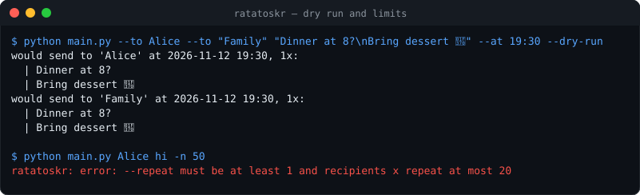
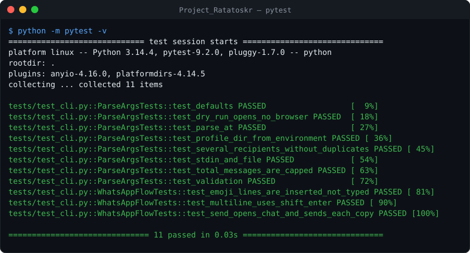
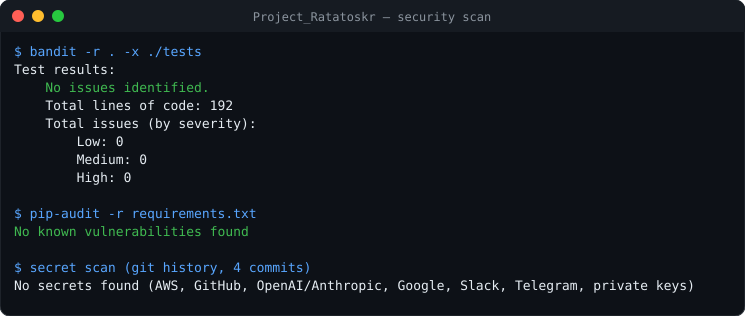

# Ratatoskr

[](https://github.com/fas0ftware/Project_Ratatoskr/actions/workflows/ci.yml)


Named after the squirrel that carries messages along Yggdrasil: sends **WhatsApp Web** messages from the command line with Selenium, using a dedicated Chrome profile so your normal Chrome and the WhatsApp login stay separate.



## Features

- One or several recipients (`--to` can be repeated), each message sent `--repeat` times.
- Multi-line messages (sent as one message using Shift+Enter) from the command line, a file (`--file`) or stdin (`-`); emoji are inserted through the browser because ChromeDriver cannot type them.
- `--at 21:30` waits and sends at that time; `--delay` between messages.
- Waits only as long as needed: continues as soon as WhatsApp is loaded (up to `--login-wait`, for the first QR scan).
- An unknown contact is reported and the others still get the message.
- `--dry-run` shows exactly what would be sent without opening a browser.
- **Not a spam tool:** at most 20 messages per run in total, at least one second apart.

## Setup

```bash
pip install -r requirements.txt     # selenium, webdriver-manager (needs Google Chrome)
```

## Usage

```bash
python main.py "Alice" "See you at 8"
python main.py --to Alice --to "Family" --file note.txt --at 21:30
printf 'line 1\nline 2' | python main.py Alice -
python main.py Alice "hi" --dry-run
```

On the first run, scan the QR code in the window that opens. The session is stored in `~/.ratatoskr_profile` (created with mode 0700; override with `--profile` or `RATATOSKR_PROFILE`), so later runs need no scan. `tools/smoke_whatsapp_web.py` opens WhatsApp Web in a clean Chrome to check that Selenium works.

## Tests

The WhatsApp flow is tested against a fake driver (search, chat, Shift+Enter line breaks, emoji insertion, repeats); the command line is tested fully (limits, stdin, files, `--at`, dry run).

```bash
pip install -r requirements-dev.txt
python -m pytest -v
```





## Limitations

- Automating WhatsApp Web is against WhatsApp's terms of use and an account can be blocked. For anything serious use the official WhatsApp Business Platform.
- The selectors depend on WhatsApp's page layout and may break at any time.
- The profile folder holds your logged-in WhatsApp session: keep it private and never commit it.

## Changelog

- **2.0.0** – Several recipients, files and stdin, multi-line and emoji messages, `--at`, `--delay`, `--dry-run`, smart waiting instead of fixed sleeps, per-contact error handling, total message cap, private profile folder, fixed the broken smoke-test script, pytest suite with a fake driver, CI with bandit + pip-audit.
- **1.0.0** – One contact, one message, fixed waits.

---

Part of the **FA Software** projects. Licensed under the [MIT License](LICENSE).
